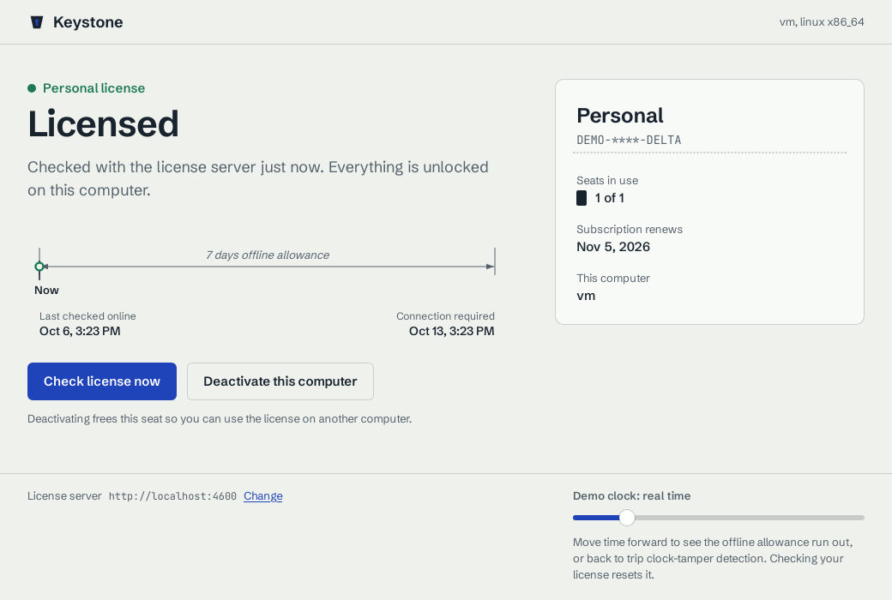
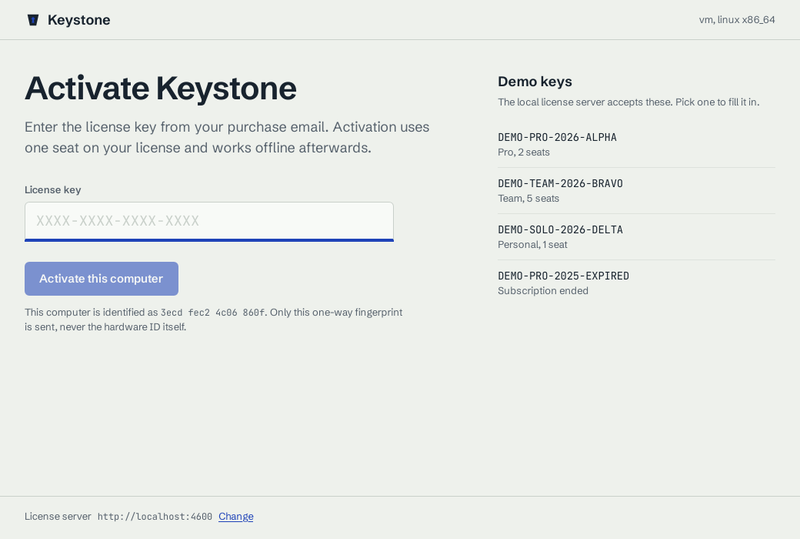
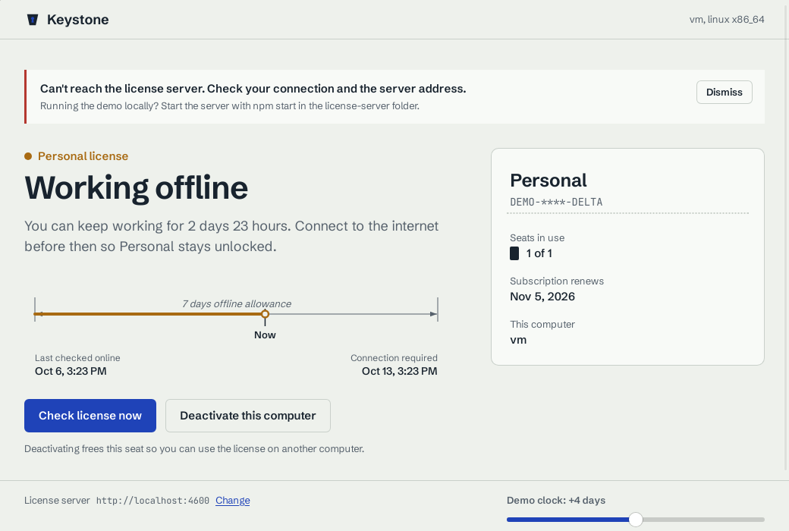
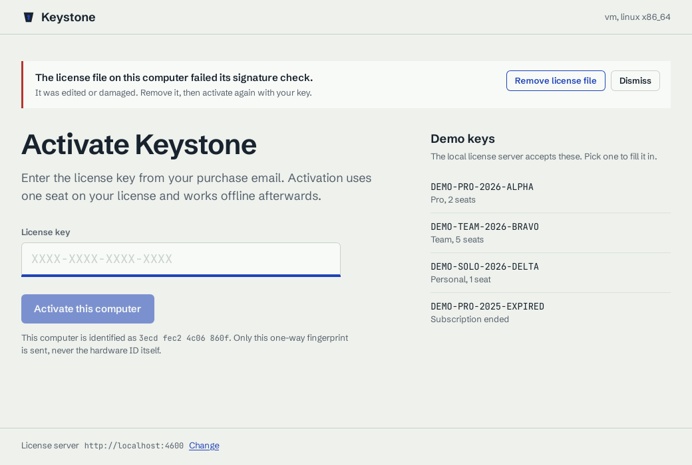
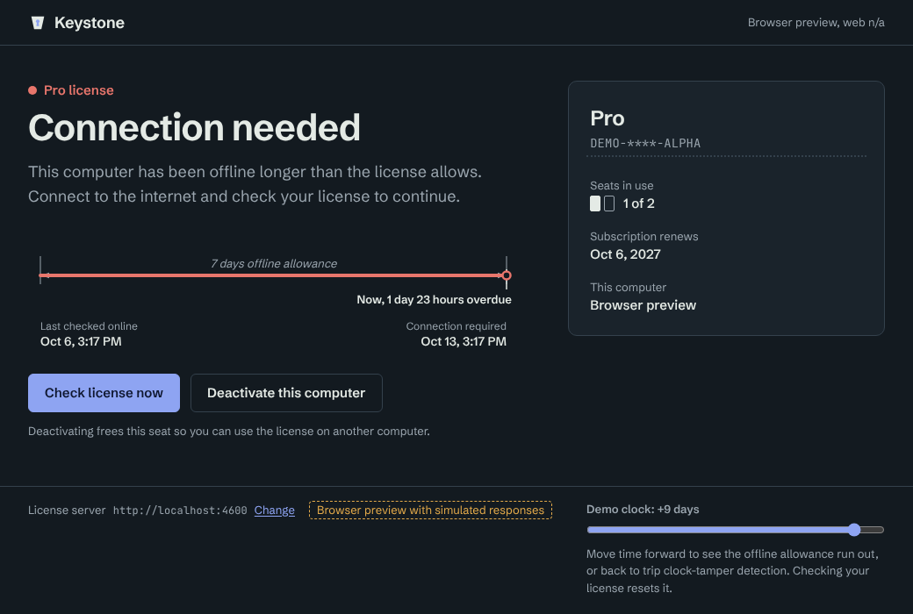
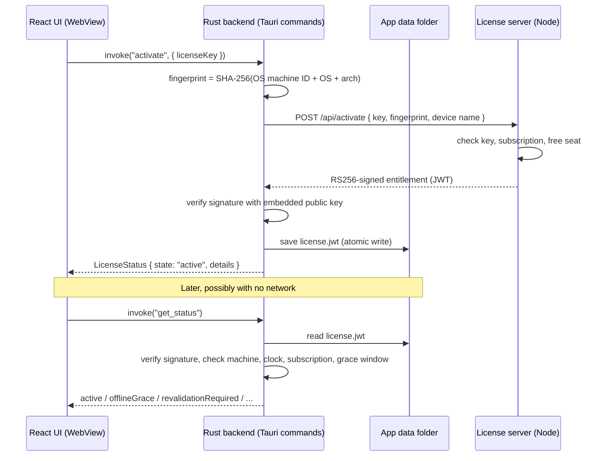

# Keystone: offline-first license activation in Tauri + React

A cross-platform desktop app (Windows, macOS, Linux) that activates a software license, verifies it **offline** with an embedded public key, enforces seat limits and an offline grace period, and detects a wound-back system clock. It comes with the small Node.js license server it talks to.

It is a compact version of the licensing problem I work on in production: activation, entitlement checks, seat management and renewals for commercial desktop software. This version is built on **Tauri 2** with a **Rust** core instead of Electron.



| Activation | Working offline (server unreachable) |
| --- | --- |
|  |  |
| **Edited license file rejected** | **Offline allowance used up (dark mode)** |
|  |  |

*Screenshots are from the release build on Linux, except the dark-mode one, which is from the browser preview. The Linux installer (`.deb`) is 2.5 MB.*

## What it shows

- **Tauri 2 + React 19 + TypeScript.** A typed IPC layer between the UI and Rust commands. The web view has no network, filesystem or shell access.
- **Rust for the sensitive parts.** HTTP, RS256 signature checks, machine fingerprinting and storage all run in Rust. The pure licensing rules live in a separate `license-core` crate with unit tests and no Tauri dependency.
- **API integration with typed errors.** Server error codes (`SEAT_LIMIT_REACHED`, `LICENSE_REVOKED`, …) pass through Rust to a TypeScript union, so the UI can respond to each case.
- **Offline-first licensing.** Signed entitlements, a 7-day offline allowance, background revalidation, seat limits, revocation, tamper detection and clock-rollback detection.
- **UI/UX for every state.** Each license state has its own plain-language message and next step. The offline allowance is drawn as a CAD-style dimension line. Light and dark themes, keyboard focus, and narrow-window layout.
- **CI.** Tests on every push, plus installer builds for macOS, Windows and Linux on GitHub Actions.

## How it works



The entitlement token carries everything the app needs to make an offline decision:

| Claim | Meaning |
| --- | --- |
| `mid` | Machine fingerprint the license is bound to |
| `iat` | Last time the server confirmed this activation |
| `exp` | `iat` + offline allowance (7 days): after this, the app must reach the server |
| `sub_exp` | When the paid subscription ends |
| `plan`, `seats_used`, `seats_max`, `key_hint` | Shown in the UI; changing them breaks the signature |

`license-core::evaluate` turns verified claims plus the current time into one of seven states: `notActivated`, `active`, `offlineGrace`, `revalidationRequired`, `subscriptionExpired`, `wrongMachine` or `clockTampered`. Serde serializes this as a tagged union, so `switch (status.state)` in TypeScript is checked for exhaustiveness.

## Repository layout

```
crates/license-core/     Pure Rust licensing rules + unit tests (no Tauri)
app/                     The desktop app
  src/                   React + TypeScript UI
    lib/api.ts           Typed wrapper over Tauri commands (+ browser preview backend)
    lib/useLicense.ts    State hook: actions, errors, background revalidation
    components/          ActivationView, LicenseView, GraceTimeline, LicenseCard, Footer
  src-tauri/             Tauri 2 shell
    src/lib.rs           Commands: activate, revalidate, deactivate, get_status, …
    src/device.rs        Machine fingerprint
    src/storage.rs       Token + settings persistence
    capabilities/        Web view permissions (core only)
license-server/          Express + jose mock vendor API + tests
dev-keys/                Demo RSA key pair (see the warning in that folder)
.github/workflows/ci.yml Tests + macOS/Windows/Linux builds
```

## Run it

You need Node 20+, Rust (stable), and the [Tauri prerequisites](https://v2.tauri.app/start/prerequisites/) for your OS.

```bash
# 1. License server (http://localhost:4600)
cd license-server
npm install
npm start

# 2. Desktop app, in a second terminal
cd app
npm install
npm run tauri dev
```

Demo keys: `DEMO-PRO-2026-ALPHA` (2 seats), `DEMO-TEAM-2026-BRAVO` (5), `DEMO-SOLO-2026-DELTA` (1), `DEMO-PRO-2025-EXPIRED`.

To work on just the UI, `npm run dev` inside `app/` opens it in a browser with a simulated backend. A dashed badge in the footer marks this mode.

### Two-minute walkthrough

1. Activate with `DEMO-SOLO-2026-DELTA`. It shows **Licensed**, using 1 of 1 seats.
2. Stop the license server and drag the **demo clock** to +4 days. The app moves to **Working offline** with the time remaining, entirely from the stored token.
3. Drag it to +9 days. Now it shows **Connection needed**.
4. Drag it to −2 days. The app reports that the **system clock looks wrong**.
5. Start the server again and click **Check license now**. The app gets a fresh token and the demo clock resets.
6. Edit `license.jwt` in the app data folder (for example, change one character in the middle part). The app rejects it as tampered.
7. Run `curl -X POST localhost:4600/api/admin/revoke -H 'x-admin-token: dev-admin' -H 'content-type: application/json' -d '{"licenseKey":"DEMO-SOLO-2026-DELTA"}'`, then check again. The app removes the revoked license.

## Design decisions

**Why the Rust side does the HTTP, not `fetch` in React.** If the web view could call the license API, any injected script could too. Keeping network, crypto and storage behind a few narrow commands means the capability file grants the web view `core:default` only, and the CSP restricts `connect-src` to Tauri IPC.

**Why asymmetric signatures.** The app holds only the public key, so it can verify entitlements but never create them. A symmetric secret embedded in the binary could be extracted and used to mint licenses.

**Why the token is stored in a plain file.** The token is signed, not secret. Editing it breaks the signature, and copying it to another computer fails the machine check. Anything actually secret, such as a refresh credential, would go in the OS keychain.

**Why expiry is not enforced at decode time.** `jsonwebtoken` would normally reject an expired token. Here the app still needs to read it to show *why* it's locked and to send it back to the server. So the signature is enforced in `Verifier`, and time-based rules are applied separately in `evaluate`, where they are easy to unit-test with a fixed clock.

**Why deactivation needs the server.** A seat only frees up if the vendor hears about it. If the request fails, the local license stays rather than silently losing a seat the customer has paid for.

**Server tokens are verified before saving.** A spoofed or intercepted response can't install a forged entitlement.

### Coming from Electron

| Electron | Tauri 2 (this repo) |
| --- | --- |
| `ipcMain.handle` + `ipcRenderer.invoke` | `#[tauri::command]` + `invoke()` from `@tauri-apps/api` |
| `preload.js` + `contextBridge` to limit renderer access | Capability files (`capabilities/default.json`) that grant permissions per window |
| Main process in Node.js | Backend in Rust: same role, compiled and memory-safe |
| Bundled Chromium | The OS web view (WebView2, WKWebView, WebKitGTK); smaller installers, and you test against each engine |
| `electron-builder` | `tauri build` / `tauri-action` in CI |

## Tests

```bash
cd license-server && npm test          # 7 API tests: activation, seats, expiry, revalidation, tampering, revocation
cargo test -p license-core             # 9 unit tests: signatures, audience, state transitions, machine binding, clock rollback
cd app && npm run build                # strict TypeScript check + production build
```

## Production next steps

- Store the server's private key in a KMS and add a `kid` header, so keys can be rotated without breaking installed apps.
- Back the server with a real database (licenses, activations, audit log), and add rate limiting on `/activate`.
- Code-sign and notarize the installers, and add the Tauri updater plugin with signed update manifests.
- Build without the demo clock: `npm run tauri build -- -- --no-default-features`.

## License

MIT
